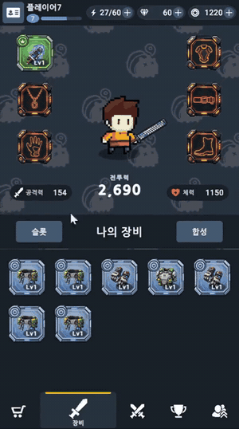
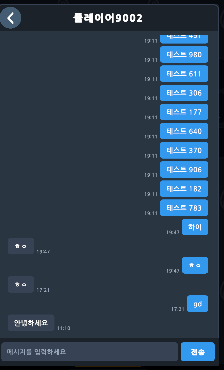
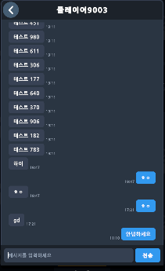
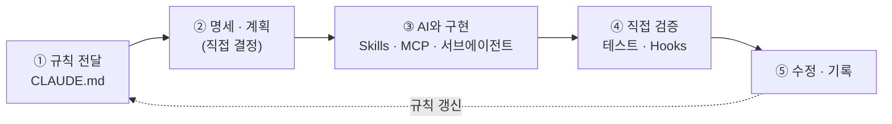

<div align="center">

# Force Push Syndrome

### 장비 수집형 뱀파이어 서바이벌 RPG


7조 **"코딩특공대"** · Unity + Spring Boot 팀 프로젝트

개발기간 : 2026.09.23 ~ 2026.10.21　|　개발인원 : 6명 (클라이언트·서버 겸업)

[📡 itch.io에서 플레이](https://jyj8943.itch.io/force-push-syndrome) · [🎬 시연 영상](https://youtu.be/2BoeA4nRx7Q) · [📂 팀 레포지토리](https://github.com/orgs/CodingOperationUnit/repositories)

##### 📌 이 문서는 팀 프로젝트 중 **제(조한웅)가 담당한 파트를 중심으로** 작성했으며, 팀 전체 구성은 [CONTRIBUTORS](#-contributors)에 정리했습니다.

</div>

<br></br>

## 목차

1. [프로젝트 소개](#-프로젝트-소개)
2. [프로젝트 목표](#-프로젝트-목표)
3. [게임 주요 사진 · 기능](#-게임-주요-사진--기능)
4. [인프라 설계도](#-인프라-설계도)
5. [서버 배포 · 운영 (AWS EC2)](#-서버-배포--운영-aws-ec2)
6. [적용 기술](#-적용-기술)
7. [기술적 의사결정](#-기술적-의사결정)
8. [내가 구현한 기능 (한웅)](#-내가-구현한-기능-한웅)
9. [트러블슈팅](#-트러블슈팅)
10. [AI 활용 개발 워크플로우](#-ai-활용-개발-워크플로우-한웅)
11. [CONTRIBUTORS](#-contributors)
12. [레포지토리 구성 · 실행 방법](#-레포지토리-구성--실행-방법)

---

# 🔨 프로젝트 소개

> 게임에 치명적인 버그가 발생하자 **"코딩특공대"** 가 직접 게임 속으로 들어갑니다. 플레이어는 클라이언트 숲, 코드 조각이 떠다니는 하늘, 데이터 저장소, 서버가 불타는 과부하 지대, 뒤틀린 글리치 공간까지 **5개 스테이지**에서 버그 몬스터를 처치합니다. 전투가 끝나면 장비를 얻어 장착하고, 합성·강화·진화로 캐릭터를 키워 더 깊은 스테이지로 내려갑니다.

| 🕹️ 한 손으로 즐기는 쉬운 전투 | 🧩 스킬을 선택하고 조합 | 🛠️ 수집하고 키워 강해지는 재미 |
| --- | --- | --- |
| 이동만 하면 공격과 스킬이 자동으로 발동해 복잡한 조작 없이 가볍게 즐깁니다. | 레벨업마다 스킬을 고르고 패시브와 조합해 나만의 빌드를 세웁니다. | 전투 후 얻은 장비를 합성·강화하고 플레이어를 진화시켜 더 깊은 곳에 도전합니다. |

| 구분 | 내용 |
| --- | --- |
| 클라이언트 | Unity 6000.3.24f1 |
| 서버 | Java 21, Spring Boot 4.1, Spring Security, JWT, WebSocket, Spring Data JPA |
| 데이터베이스 | MySQL 8.4, Redis 7.4 |
| 인프라 | AWS EC2, Docker Compose |

# 🖥️ 프로젝트 목표

버그를 잡으며 성장하는 장비 수집형 뱀파이어 서바이벌 게임. 이동만 하면 스킬이 자동 발동하는 가벼운 전투와, 전투가 끝나도 **장비 수집·합성·강화·진화로 이어지는 성장 루프**로 "한 판이 끝나도 다시 도전하고 싶은 게임"을 목표로 했습니다.

### 기술적 목표

- ⚠️ **서버 권위형 게임 설계**: 재화·경험치·장비 지급과 스테이지 입장을 서버가 판정합니다. 전투 결과는 스테이지 상한으로 검증한 값만 지급하고, 넘는 값은 의심 활동으로 기록해 클라이언트 조작을 막습니다.
- 🪪 **데이터 중심 콘텐츠 확장**: 몬스터·스킬·스테이지를 구글 시트 기반 JSON 21종으로 정의하고 버전으로 동기화해, 코드 수정 없이 콘텐츠를 추가하고 밸런스를 조정합니다.
- 💬 **Redis 기반 랭킹과 WebSocket 채팅**: 랭킹 4종과 접속 상태를 Redis로 처리하고, 친구 채팅은 WebSocket으로 푸시하며 연결이 끊기면 자동으로 재연결합니다.

### 🌏 배포 및 출시

AWS EC2와 Docker Compose(MySQL·Redis) 환경에 서버를 실제로 배포했습니다. 이후 itch.io에서 바로 플레이할 수 있도록 WebGL 빌드로 다시 만들고 HTTPS/WSS 통신으로 재설계할 예정이며, 구글 플레이스토어 출시도 준비합니다.

---

# 📸 게임 주요 사진 · 기능

### ⚔️ 전투 플레이

  

- **자동 전투**: 이동만 하면 장착한 스킬이 자동 발동하고, 몬스터를 처치하면 경험치 잼과 골드가 드롭됩니다.
- **스킬 선택과 빌드**: 레벨업하면 세 장의 후보 중 하나를 골라 스킬을 얻거나 강화합니다. 액티브·패시브를 각각 최대 6개까지 장착합니다.
- **스킬 진화**: 액티브 스킬을 5레벨까지 키우고 짝이 되는 패시브를 갖추면 더 강한 스킬로 진화합니다.
- **행운 열차**: 행운 상자를 먹으면 룰렛이 돌아가고, 결과에 따라 보유 스킬의 등급이 한꺼번에 오릅니다.
- **스테이지와 보스**: 5개 스테이지에서 시간이 지나면 엘리트와 중간 보스가 나타나고, 마지막 보스를 처치하면 클리어합니다.
- **드롭 아이템**: 경험치잼·골드 외에 회복약, 자석, 폭탄이 떨어지며 수천 개가 쌓여도 부드럽게 동작합니다.

### 🛠️ 장비 · 성장

   

- **장비 수집**: 전투가 끝나면 보상상자에서 장비를 얻습니다. 무기·방어구·벨트·장갑·목걸이·신발 6개 슬롯에 장착하며, 일반·우수·레어 등급이 있습니다.
- **합성과 강화**: 같은 장비를 합성해 등급을 올리고, 골드로 장비 레벨을 올립니다.
- **플레이어 진화**: 골드로 캐릭터 스탯을 진화시키며, 계정 레벨이 오를수록 더 많은 단계까지 진화합니다.
- **상점과 업적**: 보석·골드·보급상자를 구매하고, 업적 25종을 달성해 보상을 받습니다.

### 🖇️ 계정 · 소셜

 

- **계정과 이어하기**: 로그인하면 진행 상황이 서버에 저장되어 언제든 이어서 플레이합니다.
- **랭킹**: 계정 레벨, 최고 스테이지, 스테이지별 생존 시간, 전투력 순위를 확인합니다.
- **친구와 채팅**: 친구를 검색해 요청하고, 접속 상태를 확인하며, 실시간으로 채팅합니다.

---

# 🗺️ 인프라 설계도

### 시스템 인프라 구성

Unity 클라이언트, AWS EC2의 Spring Boot, Docker Compose로 띄운 MySQL·Redis, 그리고 구글 시트에서 JSON을 만들어 jar에 넣는 데이터 파이프라인과 배포 흐름입니다.


### ERD


### 전투 정산 흐름 (서버 권위)

입장할 때 서버가 세션을 만들고, 결과는 서버가 검증한 값만 지급합니다.


---

# 🚀 서버 배포 · 운영 (AWS EC2)

> 로컬에서만 돌리던 서버를 **AWS EC2에 실제로 배포해 운영**했습니다. (구축·배포 스크립트 담당: 주용진, 팀 공통 작업)

| 구성 | 내용 |
| --- | --- |
| 서버 | AWS EC2 한 대에 Spring Boot(jar)를 `nohup`으로 실행, 탄력적 IP 사용 |
| DB·캐시 | **Docker Compose**로 MySQL 8.4 · Redis 7.4 실행 (버전 고정, 로컬과 같은 구성) |
| 보안 | DB·Redis 포트는 `127.0.0.1`에만 바인딩, Redis 비밀번호 필수, 비밀번호는 `.env`로 분리 |
| 배포 | PowerShell 스크립트(`deploy.ps1`) 한 번으로 **빌드 → 업로드 → 기존 서버 종료 → jar 교체 → 재기동 → 접속 확인** |
| 안전장치 | 교체 전 기존 jar를 `app-old.jar`로 백업, 기동 로그(`Started`) 자동 감지와 120초 타임아웃, 실패 시 로그 출력, `-Rollback` 옵션으로 이전 버전 복구 |

**왜 자동화했나** — 정적 데이터(JSON)가 jar에 포함되어 있어 코드뿐 아니라 데이터 하나만 고쳐도 재배포가 필요했고(정적 데이터 버전이 5.2.x까지 올라갈 만큼 반영이 잦았습니다), 수동 배포는 약 12단계를 매번 직접 입력해야 했습니다.

| 지표 | 수동 배포 | `deploy.ps1` |
| --- | --- | --- |
| 조작 단계 | 12단계 | 명령 1회 |
| 소요 시간(빌드 제외) | 약 3~7분 (추정) | 약 20초 (실측, 1회) |
| 롤백 | 수동 절차 반복 | `-Rollback` 1회 |
| 기동 확인 | 로그를 눈으로 확인 | `Started` 자동 감지 |

**한계와 다음 단계** — 서버를 껐다 켜는 방식이라 배포 중 짧은 다운타임이 있고(무중단 배포 아님), 접속 확인이 HTTP 기준입니다. itch.io WebGL 빌드에 맞춰 **HTTPS/WSS로 전환**하는 작업과 함께 확인 단계도 바꿀 예정입니다.

---

# 🧰 적용 기술

| 기술 | 선택 근거 · 목적 |
| --- | --- |
| **Spring Boot + Spring Data JPA** | REST API, 보안, WebSocket, 데이터 접근을 한 프로젝트에서 구현하려고 선택했습니다. 재화와 장비처럼 정합성이 중요한 로직은 트랜잭션과 행 잠금으로 처리했습니다. 팀이 캠프에서 배운 스택이라는 점도 근거였습니다. |
| **Spring Security + JWT** | 세션 없는 Stateless 인증입니다. 토큰에 `playerId`를 담아 요청마다 프로필을 조회하지 않게 했고, 비밀번호는 BCrypt로 해시했습니다. |
| **MySQL + Redis** | 계정·재화·장비·전투 기록은 MySQL에, 랭킹(ZSET)·접속 상태(TTL)·로그인 시도 제한은 Redis로 처리했습니다. DB가 원본이고 Redis는 조회용이라, Redis에 장애가 나도 전투 정산은 성공하고 서버 재시작 시 DB로 복구됩니다. |
| **WebSocket** | 친구 채팅을 폴링 없이 실시간으로 전달하려고 도입했습니다. 느린 클라이언트가 전체 전송을 막지 않도록 서버에 전송 시간과 버퍼 제한을 두었고, 클라이언트는 끊기면 자동 재연결합니다. |
| **Google Sheets + 정적 데이터 JSON** | 기획 데이터를 시트 한 곳에서 관리하고 JSON으로 내보내 서버와 클라이언트가 같은 데이터를 쓰게 했습니다. 접속할 때 버전이 다를 때만 내려줘서 앱 재설치 없이 밸런스를 반영합니다. |
| **Docker Compose + AWS EC2** | MySQL과 Redis를 로컬과 서버에서 같은 구성으로 실행하고, DB 포트는 내부에만 열었습니다. 배포 스크립트로 빌드·업로드·교체·롤백을 자동화했습니다. |
| **JUnit 5 + Testcontainers** | 실제 MySQL 컨테이너에서 동시성과 서버 검증 로직까지 통합 테스트로 검증했습니다. 약 160개 케이스입니다. |
| **Unity ECS + Job System + Burst** | 경험치 드롭이 수천 개까지 늘고 자석 아이템으로 한꺼번에 당겨지는 성능 병목을 예상해, ECS와 Burst로 최적화하기로 결정했습니다. |

---

# 🧭 기술적 의사결정

<details>
<summary><b>정적 데이터는 DB 대신 jar 포함 JSON을 메모리에 적재</b></summary>

- ⚠️ **상황**: 몬스터·스킬·스테이지 같은 기획 데이터를 서버와 클라이언트가 어긋나지 않게 공유해야 했습니다.
- 🚧 **검토한 선택지**: DB 테이블 적재 / Redis 저장 / 서버가 구글 시트를 직접 읽기 / 클라이언트 빌드에만 포함
- 🆕 **결정**: 구글 시트에서 JSON을 내보내 jar에 포함하고, 서버가 시작할 때 메모리에 적재했습니다. 클라이언트는 접속할 때 버전을 비교해 다를 때만 내려받습니다.
- 💫 **이유**: DB 적재는 테이블마다 엔티티와 로더가 필요하고 배열 필드를 쪼개야 합니다. Redis는 서버마다 같은 파일을 읽으면 되므로 공유 저장소의 이점이 없습니다. 시트를 직접 읽으면 편집 중인 값이 운영에 들어갑니다. 빌드에만 넣으면 데이터를 바꿀 때마다 앱을 업데이트해야 합니다.
</details>

<details>
<summary><b>전투 정산은 DB 세션과 서버 검증으로 처리</b></summary>

- ⚠️ **상황**: 전투는 클라이언트가 진행하지만, 보상은 서버가 안전하게 지급해야 했습니다.
- 🚧 **검토한 선택지**: 세션 저장(서버 메모리 / DB) · 결과 전송(확인 버튼 / 결과창 진입 시) · 상한 초과(거부 / 상한까지 지급)
- 🆕 **결정**: 입장할 때 서버가 DB에 전투 세션을 만들고, 결과창을 열 때 결과를 전송하며, 상한을 넘는 값은 상한까지만 지급했습니다.
- 💫 **이유**: 세션이 서버 메모리에 있으면 서버를 여러 대로 늘렸을 때 다른 인스턴스가 세션을 찾지 못합니다. 결과창에서 앱을 꺼도 결과가 남아야 해서 전송 시점을 앞당겼고, 상한 초과를 거부하면 클라이언트 오차 하나로 결과 전체를 잃기 때문입니다.
</details>

<details>
<summary><b>시각은 UTC <code>Instant</code>로 통일하고 스태미나는 조회할 때 계산</b></summary>

- ⚠️ **상황**: 개발 PC(KST)와 클라우드(UTC)에서 기록한 시각이 섞일 수 있었고, 스태미나 회복 방식도 정해야 했습니다.
- 🆕 **결정**: `Instant`와 `Clock` 빈으로 UTC 기준을 통일하고, 스태미나는 마지막 갱신 시각과 현재 시각으로 조회할 때 계산했습니다.
- 💫 **이유**: `LocalDateTime`은 실행 환경마다 값이 달라집니다. `Clock` 빈을 쓰면 테스트에서 시각을 고정할 수 있고, 스태미나는 별도 저장 없이도 언제 계산하든 같은 값이 나옵니다.
</details>

<details>
<summary><b>랭킹은 Redis ZSET으로 조회하고 원본은 DB에 유지</b></summary>

- ⚠️ **상황**: 랭킹 4종을 빠르게 조회하면서도 Redis가 비어도 복구할 수 있어야 했습니다.
- 🚧 **검토한 선택지**: 조회(DB 집계 쿼리 / Redis ZSET) · Redis 갱신 시점(트랜잭션 안 / 커밋 이후)
- 🆕 **결정**: 조회는 Redis ZSET, 갱신은 트랜잭션 커밋 이후 이벤트로 했습니다. Redis가 실패해도 전투 정산은 성공하고, 서버 시작 시 DB 기록으로 Redis를 다시 만듭니다.
- 💫 **이유**: DB 집계는 조회할 때마다 전체를 정렬해야 합니다. 갱신을 트랜잭션 안에서 하면 Redis 장애가 보상 지급까지 막습니다. DB를 원본으로 두면 Redis가 비어도 복구할 수 있습니다.
</details>

<details>
<summary><b>대량 드롭아이템은 ECS로 처리하고 렌더링은 GameObject로 분리</b></summary>

- ⚠️ **상황**: 수천 개의 드롭아이템이 바닥에 쌓여도 프레임이 유지돼야 했습니다.
- 🚧 **검토한 선택지**: 아이템마다 MonoBehaviour / ECS + Entities Graphics로 모두 처리 / ECS는 로직만, 렌더링은 GameObject
- 🆕 **결정**: 감지와 이동은 ECS와 Burst로 처리하고, 화면 표시는 오브젝트 풀의 GameObject에 위치만 동기화했습니다.
- 💫 **이유**: Entities Graphics는 SpriteRenderer를 지원하지 않고 URP에서는 Forward+만 지원해, 이 프로젝트의 2D Renderer로는 엔티티를 직접 그릴 수 없었습니다. 바닥의 아이템은 별도 아키타입으로 분리해 이동 쿼리가 순회하지 않게 했습니다.
</details>

---

# 🙋 내가 구현한 기능 (한웅)

> 장비·인벤토리, 상점, 랭킹, 친구, 접속 상태, 1:1 채팅을 **서버와 클라이언트 UI까지** 구현했습니다.

### 1. 장비 · 인벤토리

 

- 장착/해제(같은 슬롯은 교체), 골드 레벨업(비용 `1000 × 레벨`, 최대 10레벨), 단일·일괄 합성 API를 구현했습니다.
- **합성**: 대상 장비 1개 + **같은 아이템·같은 등급의 미장착 장비 2개**를 소모합니다. 재료는 id 오름차순으로 골라 결과가 항상 같게 했고, 일괄 합성도 지원합니다.
- **플레이어 단위 락**으로 동시 요청을 직렬화했습니다. ([트러블슈팅 1](#1-장비-합성레벨업-동시-요청이-겹쳐-처리되는-문제))
- 장착 장비가 바뀌면 전투력 랭킹 갱신 이벤트를 발행합니다.
- 클라이언트 장비창은 슬롯 구성, 정렬, **합성 가능 표시**를 제공합니다.

### 2. 상점

- 골드·젬 구매 API 초안과 구매 카드 UI 연동을 구현했습니다. (이후 보안 감사에서 젬 상품은 결제 검증 없이는 구매가 거부되도록 보강되었습니다.)

### 3. 랭킹 (Redis Sorted Set)


- 계정 레벨, 최고 스테이지, 전투력 랭킹을 Redis ZSET으로 구현하고 랭킹 UI를 만들었습니다.
- 점수를 `값 × 10,000,000 + (10,000,000 − 1 − playerId)`로 인코딩해 **동점이면 먼저 달성한 플레이어가 위**에 오도록 순위를 고정했습니다.
- DB 커밋 후(`AFTER_COMMIT`) 이벤트로 Redis에 반영하고(멱등), 서버 시작 시 DB 전체로 Redis를 재구성합니다. 전투력은 DB에 저장하지 않고 계산해서 반영합니다.

### 4. 친구 · 접속 상태


- 친구 검색·요청·수락·거절·삭제 API와 친구창 UI를 구현했습니다. 한 쌍을 낮은 id/높은 id로 정규화한 **유니크 제약**으로 중복을 막고, 서로 요청하면 자동 수락됩니다. 친구는 최대 50명입니다.
- **Redis heartbeat**: 클라이언트가 30초마다 `presence:{id}`를 TTL 60초로 갱신하고, 친구 목록은 `multiGet` 한 번으로 접속 상태를 조회하며 전투력도 함께 보여줍니다.

### 5. 1:1 채팅 (REST + WebSocket)

 

- **전송·내역은 REST**, **새 메시지 알림은 WebSocket push**로 나눴습니다. 핸드셰이크에서 인증하고 DB 커밋 이후에 push하며, 느린 클라이언트를 위해 전송 5초·버퍼 64KB 제한을 두었습니다. 친구끼리만, 200자까지 가능합니다.
- 클라이언트(`ChatSocket`, `ServerChatManager`): 1·2·4·8초 백오프 재연결, 25초 ping, **재접속 시 마지막 메시지 id 이후만 조회해 누락 복구**, 3초 이상 끊기면 폴링 전환, 메시지 id 중복 제거.

---

# 🔧 트러블슈팅

### 1. 장비 합성·레벨업 동시 요청이 겹쳐 처리되는 문제

- ⚠️ **문제**: 같은 플레이어의 장착·합성·레벨업 요청이 동시에 들어오면 같은 잔액·장비 상태를 보고 둘 다 통과해 중복 처리될 위험이 있었습니다.
- 📊 **원인**: 재화 행을 `findById`로 잠금 없이 읽는 "확인 후 실행" 구조였고, 레벨업은 장비를 먼저 읽고 잠금을 기다려 오래된 값으로 검증할 수 있었습니다.
- 🆗 **해결**: 재화 행을 `findForUpdate`(비관적 락)로 읽는 **플레이어 단위 뮤텍스**를 도입하고, 장착·합성도 `lockPlayer()`로 같은 행을 먼저 잠그게 했습니다. 레벨업은 잠금을 장비 조회보다 앞으로 옮겼습니다.
- ➡️ **결과**: 이 규칙이 상점·전투·진화에도 이어져 재화 행이 플레이어 단위 직렬화 지점이 되었습니다.

### 2. 랭킹 조회 부하 (DB 집계 → Redis ZSET)

- ⚠️ **문제**: DB 집계는 조회할 때마다 전체를 정렬해야 해서 접속자가 늘수록 부하가 커집니다.
- 🆗 **해결**: 조회는 Redis ZSET, 원본은 DB로 역할을 분리하고, 갱신은 커밋 이후 이벤트로 처리해 Redis 장애가 보상 지급을 막지 않게 했습니다.

### 3. 채팅 연결이 끊겼을 때 메시지 누락

- ⚠️ **문제**: 네트워크 전환·앱 백그라운드 복귀로 WebSocket이 끊기면 그 사이 메시지가 사라집니다.
- 🆗 **해결**: WebSocket은 알림 채널로만 쓰고 원본은 REST로 조회합니다. 재접속 시 마지막 id 이후만 가져오고, 끊긴 동안은 폴링으로 보완합니다.

---

# 🤖 AI 활용 개발 워크플로우 (한웅)

> AI는 **구현 초안과 반복 작업을 빠르게 처리하는 도구**로 적극 활용하되, **무엇을 만들지 정하는 일, 설계 판단, 디버깅, 최종 검증은 직접** 했습니다. 구현의 상당 부분은 AI의 도움을 받았고, 그 결과를 이해하고 책임지는 것은 제 몫이라고 생각하고 작업했습니다.

### 역할 분담

| 내가 직접 한 일 | AI와 함께 한 일 |
| --- | --- |
| 기능 범위와 우선순위 결정 | 명세서·계획서 초안 작성 |
| 구조·설계 결정 (서버 권위, 락 방식, Redis 사용 범위) | 설계 대안 정리와 장단점 비교 |
| 버그 원인 파악과 재현, 수정 방향 결정 | 코드 초안, 반복적인 DTO·CRUD·테스트 코드 작성 |
| AI 코드 리뷰·수정, 테스트 실행과 결과 확인 | 코드 탐색, 리뷰 보조, 문서 정리 |
| 팀원과의 협의, 커밋·배포 | 커밋 메시지·README 초안 |

### 개발 흐름



1. **규칙 전달** — 작업 전에 `CLAUDE.md`로 프로젝트 구조, 코딩·커밋 규칙, 지켜야 할 원칙을 알려줘서 AI가 같은 기준으로 답하게 했습니다.
2. **명세·계획** — 무엇을 만들지는 제가 정하고, AI와 명세서 초안을 여러 번 고쳐서 확정했습니다.
3. **구현** — 반복되는 작업은 Skills로 절차를 정리하고, Notion 같은 외부 문서는 MCP로 연결하고, 리뷰·명세 작성처럼 독립적인 일은 서브에이전트에 맡겼습니다.
4. **검증** — AI가 쓴 코드는 그대로 쓰지 않고 직접 읽고 테스트로 확인했습니다. 비밀 파일 수정이나 위험한 명령은 Hook으로 막았습니다.
5. **수정·기록** — 틀린 부분은 직접 고치고, 결정 이유는 문서로 남겼습니다.

설정 파일은 레포에 포함되어 있습니다. (`CLAUDE.md`, `.claude/`, `.mcp.json`)

### 활용 사례

- **명세 먼저 만들기** — 장비·인벤토리·상점 API를 구현하기 전에 AI와 명세서를 v1→v4까지 다듬었습니다. AI가 초안을 쓰고, 오류 규칙과 요청·응답 구조는 제가 판단해 확정했습니다.
- **동시성 문제** — 같은 플레이어의 요청이 겹칠 수 있다는 문제를 코드 흐름을 따라가며 찾았습니다. AI가 제안한 수정안을 그대로 쓰지 않고 diff를 읽어 플레이어 단위 락으로 범위를 정해 반영했습니다.
- **설계 대안 비교** — 랭킹 구조를 정할 때 AI에게 대안별 장단점을 정리하게 하고, 선택은 제가 하고 이유를 문서로 남겼습니다.
- **결과 검증** — AI가 정리한 내용을 Git 기록·코드와 대조해, 잘못 기재된 부분을 찾아 바로잡았습니다.

### 배운 점
- 규칙과 맥락을 미리 줄수록 결과가 좋아졌습니다.
- AI가 쓴 코드도 **제가 설명하지 못하면 쓰지 않는다**는 기준을 지켰습니다.

---

# 👥 CONTRIBUTORS

| 이름 | GitHub | 담당 |
| --- | --- | --- |
| 주용진 (팀장) | [@jyj8943](https://github.com/jyj8943) | 계정·세이브(서버 JWT 로그인, 이어하기), 업적 시스템, AWS EC2·Docker Compose 운영, 배포 스크립트, 구글 시트 JSON 파서·`JsonDataManager` |
| 박관엽 | [@poi001](https://github.com/poi001) | 스킬 시스템 설계(`SkillBase`·`SkillFactory`·`SkillController`), 액티브 9종·패시브 9종, 스킬 진화, 스킬 전용 오브젝트 풀링 |
| 오승희 | [@Oh-Seung-Hee](https://github.com/Oh-Seung-Hee) | `Enemy` 상속 구조, 일반/엘리트/보스 몬스터, FSM 보스 AI(돌진·탄막·장판), 몬스터 정적 데이터 로딩, 전투 연출(데미지 텍스트·진동·효과음) |
| **조한웅** | [@johwoong](https://github.com/johwoong) | **장비·인벤토리, 플레이어 단위 락, 상점, Redis 랭킹, 친구·접속 상태, 1:1 채팅 (서버 + UI)** |
| 조진영 | [@Thedume](https://github.com/Thedume) | 데이터 정의서·ERD, 플레이어·전투 시스템, 장비 등급 효과, 서버 보안·테스트, 공통 모듈 `ApiClient` |
| 허민영 | [@DevAkasha](https://github.com/DevAkasha) | `UIManager`·UI 인프라, MVP 배틀 통합, **드롭아이템 ECS**, 구글 시트 Exporter |

---

# 📦 레포지토리 구성 · 실행 방법

팀 프로젝트의 클라이언트와 서버 레포지토리를 **커밋 기록을 유지한 채** 하나로 합쳤습니다.

```text
Force-Push-Syndrome/
├─ README.md          이 문서
├─ docs/images/       README 이미지
├─ COU_Client/        Unity 클라이언트
└─ COU_Server/        Spring Boot 서버 (Tools/SheetExporter 포함)
```

```bash
# 서버
cd COU_Server
cp .env.example .env        # DB_PASSWORD, REDIS_PASSWORD, JWT_SECRET 설정
docker compose up -d        # MySQL 8.4, Redis 7.4
./gradlew bootRun           # http://localhost:8080
```

클라이언트는 Unity Hub에서 **6000.3.24f1**로 `COU_Client`를 열고 `LogInScene`에서 Play 합니다.

서버 주소는 실행 환경에 따라 자동으로 바뀝니다. (`GameConstants.Server.BASE_URL`)

| 실행 환경 | 접속 서버 |
| --- | --- |
| Unity 에디터 Play | 로컬 서버 `http://localhost:8080` (위 서버 실행 필요) |
| 빌드(실제 배포 버전) | AWS EC2에 배포한 서버 |
