<div align="center">

# [Unity / Spring Boot] Force Push Syndrome

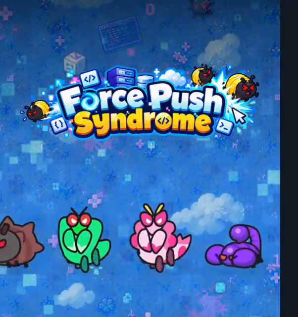

**장비 수집형 뱀파이어 서바이벌 RPG** · 7조 "코딩특공대"

개발기간 : `YYYY.MM.DD ~ YYYY.MM.DD`

개발인원 : 6명 (클라이언트·서버 겸업)

[📡 itch.io에서 플레이](https://jyj8943.itch.io/force-push-syndrome) · [🎬 시연 영상](#) · [📂 팀 레포지토리](https://github.com/orgs/CodingOperationUnit/repositories)

##### 📌 이 문서는 팀 프로젝트 중 **제가 담당한 파트를 중심으로** 작성했습니다. 팀원 전체의 구현 내용은 [팀 프로젝트 소개](#-팀-프로젝트-소개)에 요약했습니다.

</div>

<br></br>

# *담당파트*

- ***장비·인벤토리*** (장착/해제, 단일·일괄 합성, 레벨업)
- ***플레이어 단위 락을 이용한 동시성 제어***
- ***상점*** (골드·젬 구매)
- ***랭킹*** (Redis Sorted Set)
- ***친구 · 접속 상태*** (Redis heartbeat)
- ***1:1 채팅*** (REST + WebSocket)
- ***위 기능의 클라이언트 UI*** (장비창·합성, 랭킹, 친구창, 채팅)

# *게임 주요 사진*

### 전투 플레이

이동만 하면 스킬이 자동 발동하고, 레벨업마다 스킬을 골라 나만의 빌드를 만듭니다.

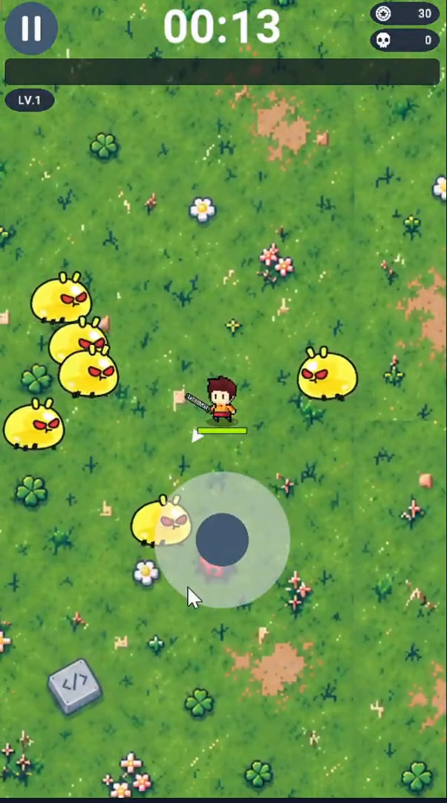 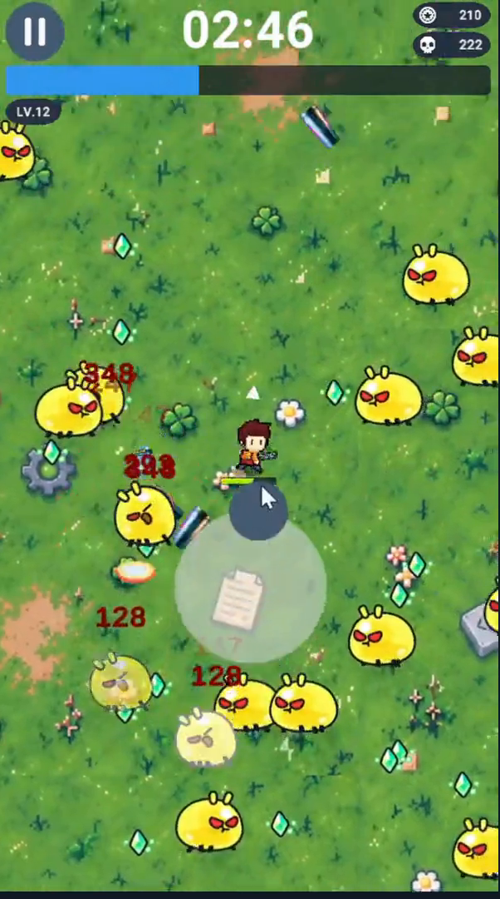 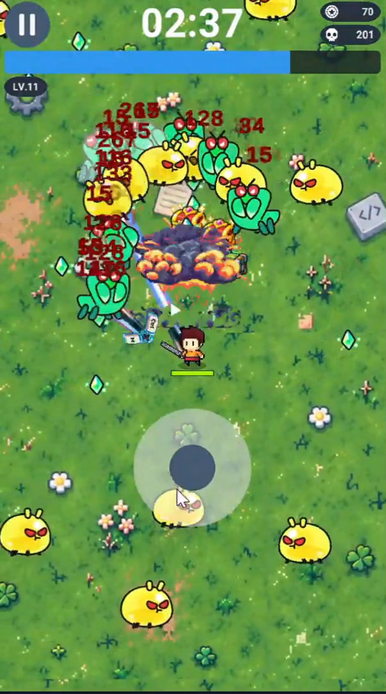

### 장비·성장

전투 후 얻은 장비를 6개 슬롯에 장착하고, 합성·강화·진화로 캐릭터를 키웁니다.

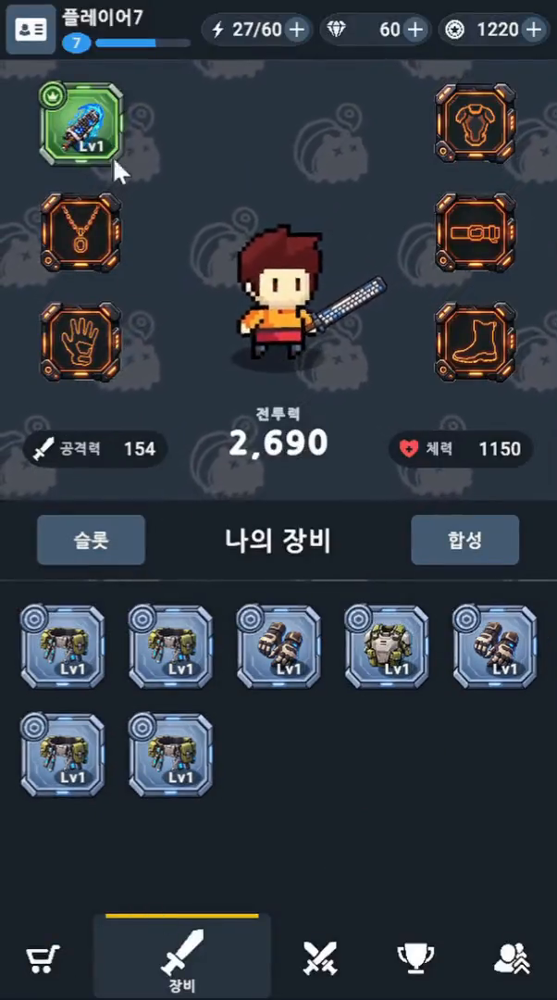 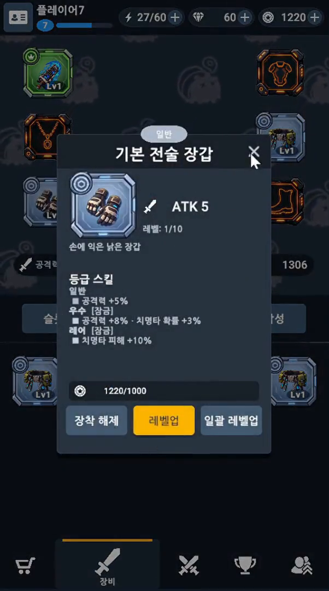 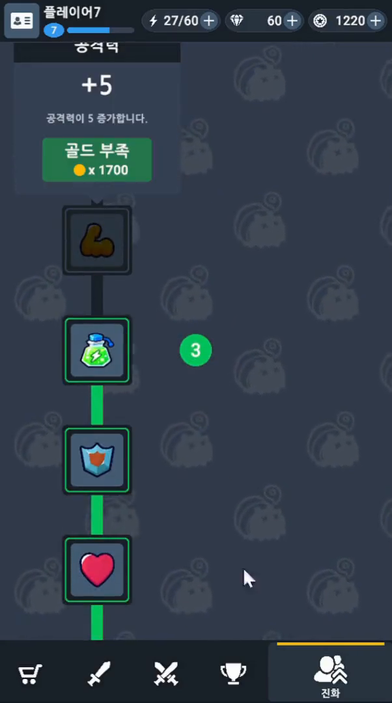 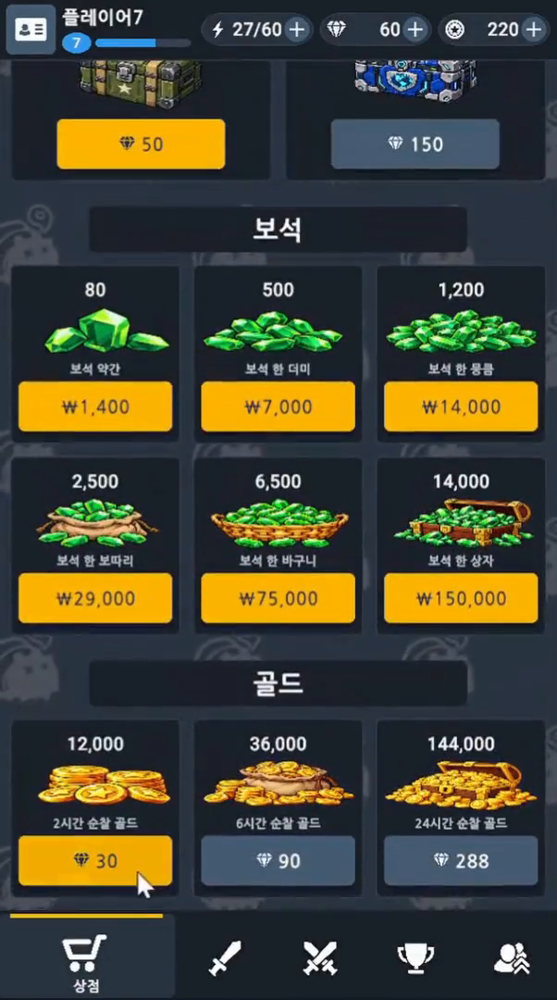

### 계정·소셜

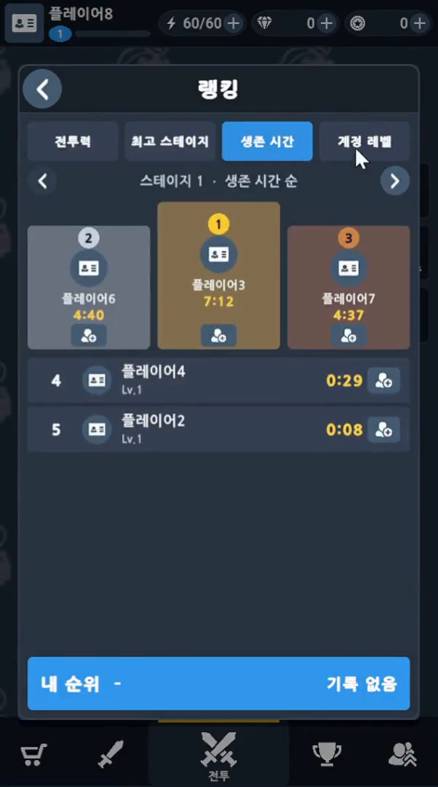 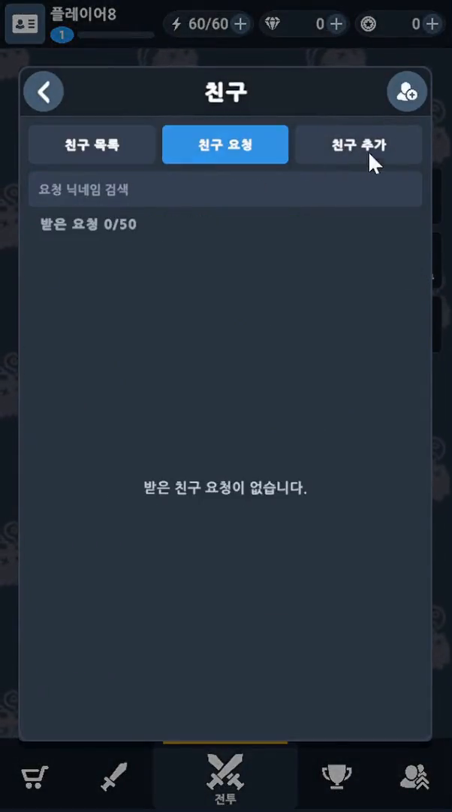

# *프로젝트 소개*

게임에 치명적인 버그가 발생하자 **"코딩특공대"** 가 직접 게임 속으로 들어가 버그 몬스터를 처치합니다. 5개 스테이지에서 싸우고, 얻은 장비를 합성·강화·진화시켜 더 깊은 스테이지에 도전하는 게임입니다.

| 구분 | 내용 |
| --- | --- |
| 클라이언트 | Unity 6000.3.24f1 · C# · URP 2D |
| 서버 | Java 21 · Spring Boot 4.1 · Spring Security · JWT · WebSocket · Spring Data JPA |
| 데이터베이스 | MySQL 8.4 · Redis 7.4 |
| 인프라 | AWS EC2 · Docker Compose |
| 테스트 | JUnit 5 · Testcontainers (실제 MySQL·Redis 컨테이너) |

### 기술 목표

- **서버 권위형 설계**: 재화·경험치·장비 지급과 스테이지 입장을 서버가 판정합니다. 전투 결과는 스테이지 상한으로 검증하고, 넘는 값은 의심 활동으로 기록합니다.
- **데이터 중심 콘텐츠**: 구글 시트 → JSON 21종을 버전으로 동기화해 코드 수정 없이 콘텐츠를 추가하고 밸런스를 조정합니다.
- **Redis 랭킹과 WebSocket 채팅**: 랭킹·접속 상태는 Redis, 친구 채팅은 WebSocket으로 푸시하고 끊기면 자동 재연결합니다.

# *인프라 설계도*

### 시스템 흐름도

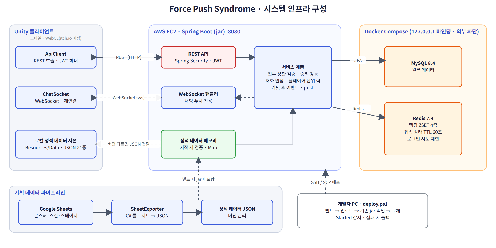 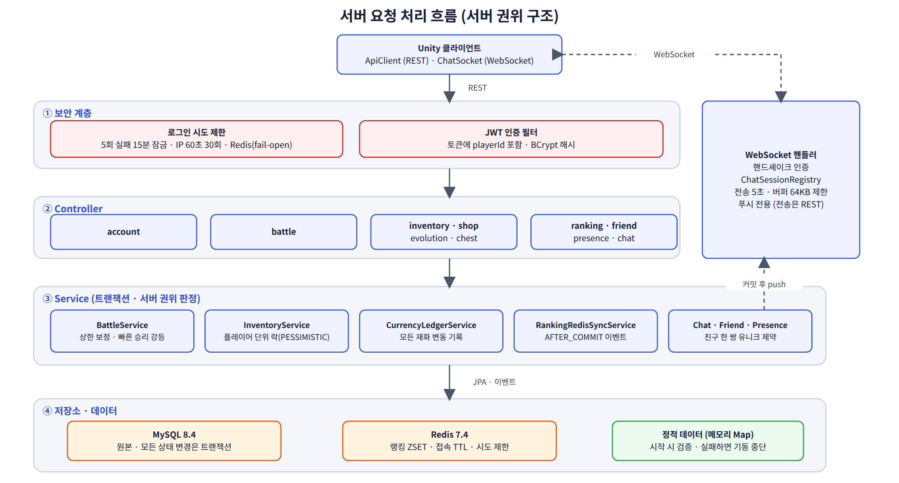

### ERD

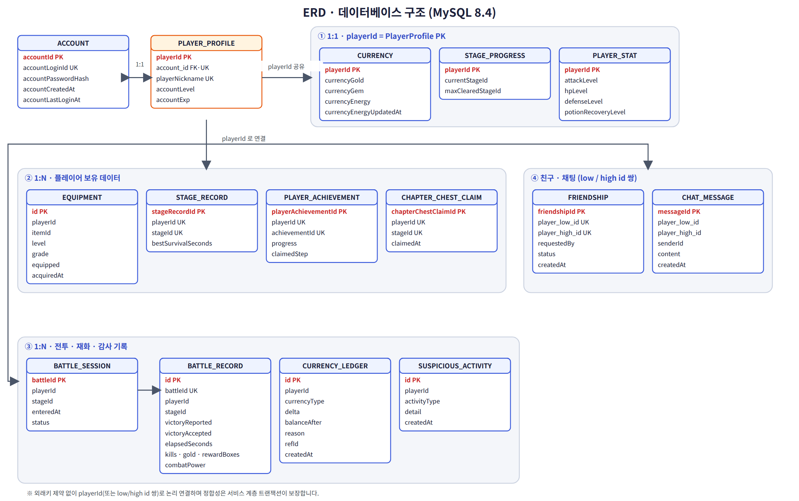

### 게임 흐름도

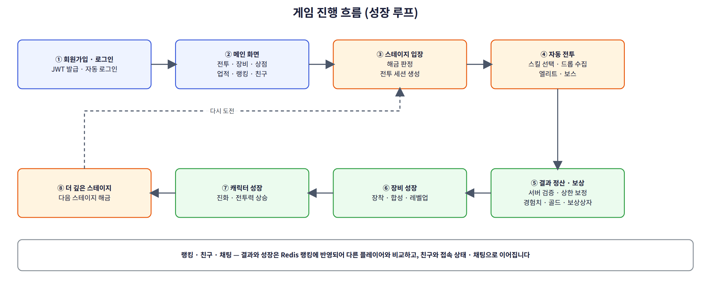 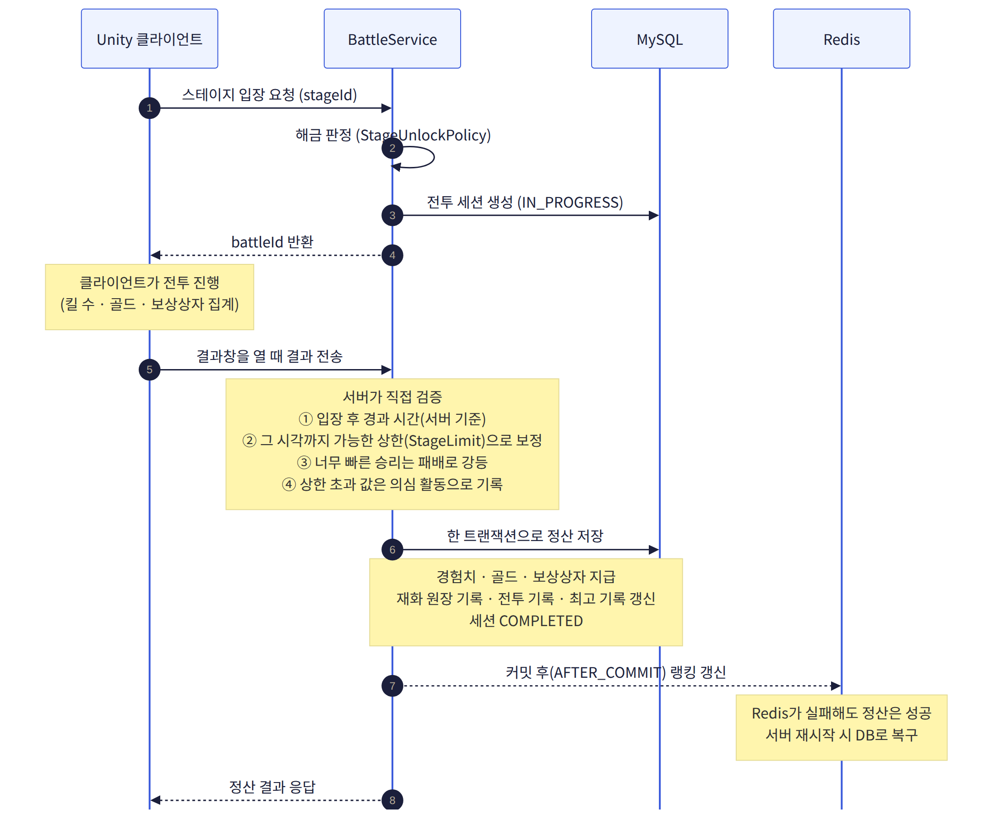

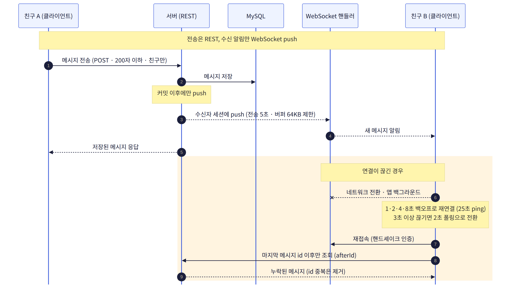 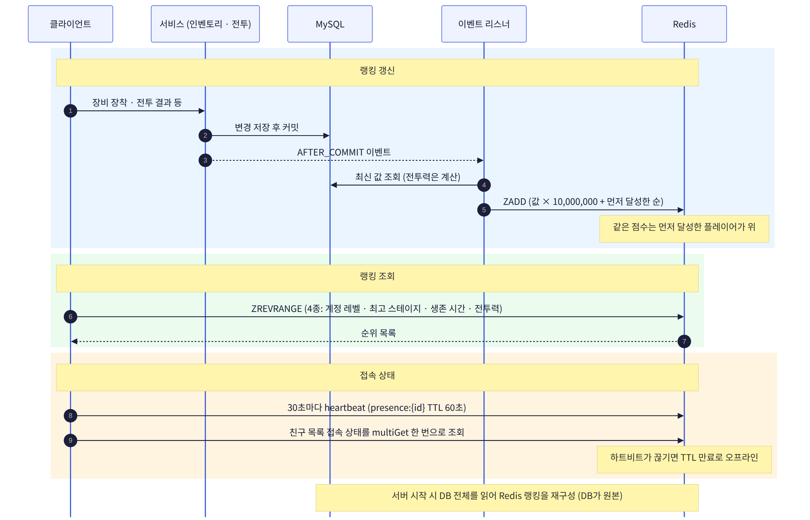

# *구현 컨텐츠 및 기능 설명*

## 1. 장비 · 인벤토리

<!-- 장비창, 합성 UI 스크린샷 또는 GIF -->
 

### 장착 / 해제 · 레벨업

- 무기, 방어구, 벨트, 장갑, 목걸이, 신발 6개 슬롯에 장착하며, 같은 슬롯에 장착하면 기존 장비가 교체됩니다.
- 골드로 장비 레벨을 올립니다. 비용은 `1000 × 레벨`이고 최대 10레벨입니다. 일괄 레벨업도 지원합니다.
- 장착 중인 장비가 바뀌면 전투력 랭킹 갱신 이벤트를 발행합니다.

### 합성 (단일 · 일괄)

- 대상 장비 1개와 **같은 아이템·같은 등급의 미장착 장비 2개**를 소모해 등급을 올립니다. 재료는 id 오름차순으로 선택해 결과가 항상 같게 했습니다.
- 일괄 합성은 가능한 만큼 반복해 한 번의 요청으로 처리합니다.
- 클라이언트 장비창은 슬롯 구성, 정렬, **합성 가능 표시**를 제공합니다.

## 2. 동시 요청 제어 (플레이어 단위 락)

- 같은 플레이어의 장착·합성·레벨업이 동시에 들어와도 중복 처리되지 않도록, **재화 행을 `findForUpdate`(비관적 락)로 읽는 플레이어 단위 뮤텍스**를 두었습니다.
- 이 규칙을 상점·전투·진화로 확장해, 재화 행이 플레이어 단위 직렬화 지점이 되도록 했습니다. (자세한 내용은 [트러블슈팅](#-트러블슈팅))

## 3. 상점

- 골드·젬 구매 API 초안과 구매 카드 UI 연동을 구현했습니다. 이후 보안 감사에서 젬 상품은 결제 검증 없이는 구매가 거부되도록 보강되었습니다.

## 4. 랭킹 (Redis)


- 계정 레벨, 최고 스테이지, 전투력 등 랭킹을 **Redis Sorted Set**으로 조회합니다.
- 점수를 `값 × 10,000,000 + (10,000,000 − 1 − playerId)`로 인코딩해, **동점이면 먼저 달성한 플레이어가 위**에 오도록 순위를 고정했습니다.
- DB가 원본이고 Redis는 조회용입니다. DB 커밋 이후(`AFTER_COMMIT`) 이벤트로 Redis에 반영하므로 Redis가 실패해도 전투 정산은 성공하고, 서버가 시작될 때 DB 전체를 읽어 Redis를 다시 만듭니다.
- 전투력은 DB에 저장하지 않고 계산해서 반영합니다.

## 5. 친구 · 접속 상태


- 친구 검색, 요청, 수락, 거절, 삭제 API와 친구창 UI를 구현했습니다.
- 한 쌍을 낮은 id / 높은 id로 정규화한 **유니크 제약**으로 중복 요청을 막고, 서로 요청하면 자동 수락됩니다. 친구는 최대 50명입니다.
- 클라이언트가 30초마다 heartbeat를 보내면 `presence:{id}` 키를 **TTL 60초**로 갱신합니다. 친구 목록은 `multiGet` 한 번으로 접속 상태를 조회하고, 전투력도 함께 보여줍니다.

## 6. 1:1 채팅 (REST + WebSocket)


- **전송과 내역 조회는 REST**, **새 메시지 알림은 WebSocket push**로 나눴습니다. 핸드셰이크에서 인증하고, DB 커밋 이후에 push합니다. 친구끼리만 가능하며 메시지는 200자까지입니다.
- 서버는 느린 클라이언트가 전체 전송을 막지 않도록 전송 시간(5초)과 버퍼(64KB) 제한을 두었습니다.
- 클라이언트(`ChatSocket`, `ServerChatManager`)는 1·2·4·8초 백오프로 재연결하고 25초마다 ping을 보냅니다. **재접속하면 마지막 메시지 id 이후만 조회해 누락을 복구**하고, 연결이 3초 이상 끊기면 폴링으로 전환하며, 메시지 id로 중복을 제거합니다.

# *트러블슈팅*

### 1. 장비 합성·레벨업 동시 요청이 겹쳐 처리되는 문제

- ⚠️ **문제**: 같은 플레이어의 장착·합성·레벨업이 동시에 들어오면 같은 잔액·장비 상태를 보고 둘 다 통과해 중복 처리될 위험이 있었습니다.
- 📊 **원인**: 재화 행을 `findById`로 잠금 없이 읽는 "확인 후 실행" 구조였고, 레벨업은 장비를 먼저 읽고 잠금을 기다려 오래된 값으로 검증할 수 있었습니다.
- 🆗 **해결**: 재화 행을 `findForUpdate`로 읽는 플레이어 단위 뮤텍스를 도입하고, 장착·합성도 `lockPlayer()`로 같은 행을 먼저 잠그게 했습니다. 레벨업은 잠금을 장비 조회보다 앞으로 옮겼습니다.
- ➡️ **결과 / 남은 과제**: 이 규칙이 상점·전투·진화에도 이어졌습니다. 동시 요청 회귀 테스트는 다음 과제입니다.

### 2. 랭킹 조회 부하 (DB 집계 → Redis ZSET)

- ⚠️ **문제**: DB 집계 쿼리는 조회할 때마다 전체를 정렬해야 해서 접속자가 늘수록 부하가 커집니다.
- 🆗 **해결**: 조회는 Redis ZSET이 처리하고 원본은 DB에 유지했습니다. 갱신은 트랜잭션 커밋 이후 이벤트로 처리해 Redis 장애가 전투 보상 지급까지 막지 않게 했습니다.

| 항목 | Before (DB 집계) | After (Redis ZSET) |
| --- | --- | --- |
| 평균 응답 시간 | `측정 후 기입` | `측정 후 기입` |
| p95 응답 시간 | `측정 후 기입` | `측정 후 기입` |
| 처리량 (req/s) | `측정 후 기입` | `측정 후 기입` |

<!-- Before / After 캡처 -->

### 3. 채팅 연결이 끊겼을 때 메시지 누락

- ⚠️ **문제**: 네트워크 전환·앱 백그라운드 복귀로 WebSocket이 끊기면 그 사이 메시지가 사라집니다.
- 🆗 **해결**: WebSocket은 알림 채널로만 쓰고 원본은 REST로 조회하게 했습니다. 재접속 시 마지막 id 이후만 가져오고, 끊긴 동안은 폴링으로 보완합니다.

# *기술적 요소*

- 서버 권위형 설계와 플레이어 단위 비관적 락
- Redis Sorted Set 랭킹 (동점 처리, AFTER_COMMIT 동기화, 시작 시 재구성)
- Redis TTL 기반 접속 상태
- WebSocket 채팅과 재접속 복구
- Testcontainers 통합 테스트

# *🏷 팀 프로젝트 소개*

| 이름 | GitHub | 담당 |
| --- | --- | --- |
| 주용진 (팀장) | [@jyj8943](https://github.com/jyj8943) | 계정·세이브, 업적, AWS EC2·Docker 배포, 배포 스크립트, 정적 데이터 JSON 파서 |
| 박관엽 | [@poi001](https://github.com/poi001) | 스킬 시스템 설계, 액티브·패시브 스킬, 스킬 진화, 스킬 오브젝트 풀링 |
| 오승희 | [@Oh-Seung-Hee](https://github.com/Oh-Seung-Hee) | 몬스터 시스템, 보스 AI·패턴, 전투 연출 |
| 조한웅 | [@johwoong](https://github.com/johwoong) | 장비·인벤토리, 상점, 랭킹, 친구, 접속 상태, 채팅 |
| 조진영 | [@Thedume](https://github.com/Thedume) | 데이터 설계·ERD, 플레이어·전투 시스템, 서버 보안·테스트 |
| 허민영 | [@DevAkasha](https://github.com/DevAkasha) | UIManager, 배틀 통합(MVP), 드롭아이템 ECS, 구글 시트 Exporter |

### 서버 보안 · 테스트

AI 보안 스캔으로 취약점 11건을 찾아 모두 수정했고, 수정마다 재현 테스트(Testcontainers)를 붙여 서버 테스트를 0개에서 160여 개로 늘렸습니다. 저장 API의 클라이언트 값 무시, 로그인 5회 실패 시 15분 잠금, 재화 변동 원장, 전투 시간 검증 등이 반영되었습니다.

### 드롭 아이템 ECS

드롭이 수천 개 쌓이는 장르 특성에 맞춰 감지·이동을 Unity ECS + Job System + Burst로 처리하고, 렌더링은 풀링한 GameObject로 분리했습니다.

# *레포지토리 구성*

팀 프로젝트의 클라이언트와 서버 레포지토리를 **커밋 기록을 유지한 채** 하나로 합쳤습니다.

```text
Force-Push-Syndrome/
├─ README.md          이 문서
├─ docs/images/       README에 쓰는 이미지
├─ COU_Client/        Unity 클라이언트 (Assets, Docs ...)
└─ COU_Server/        Spring Boot 서버 (src, Docs, Tools/SheetExporter ...)
```

# *실행 방법*

```bash
# 서버
cd COU_Server
cp .env.example .env        # DB_PASSWORD, REDIS_PASSWORD, JWT_SECRET 설정
docker compose up -d        # MySQL 8.4, Redis 7.4
./gradlew bootRun           # http://localhost:8080
```

클라이언트는 Unity Hub에서 **6000.3.24f1**로 `COU_Client`를 열고 `LogInScene`에서 Play 합니다. 서버 주소 기본값은 `http://localhost:8080`입니다.
